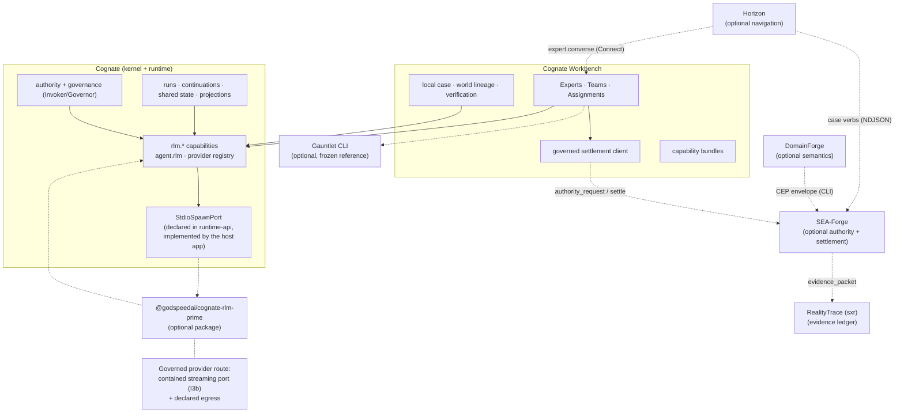
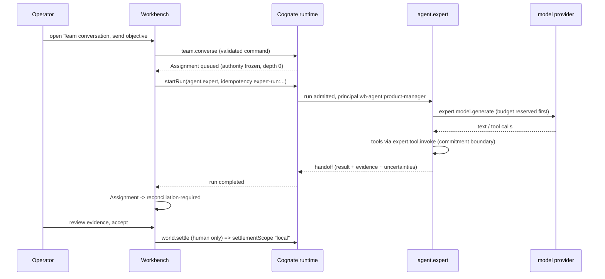
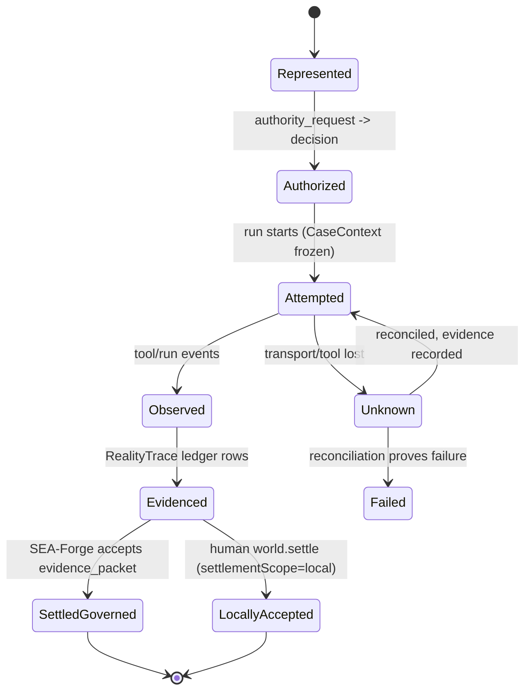
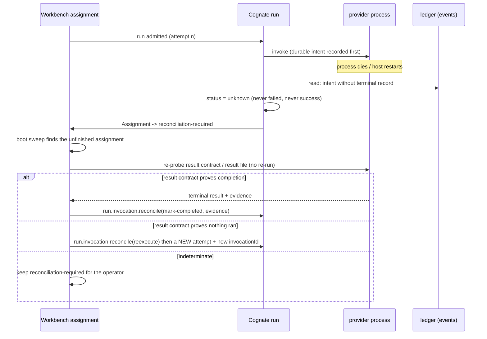
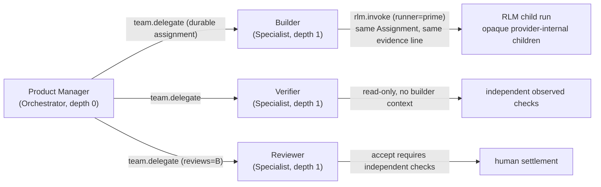

# C — Target architecture

Seven diagrams, one per required view. Solid arrows are required at runtime; dashed arrows are
optional and their absence must not break the source side.

## C1. Component ownership and optional dependencies



**Rule.** Removing any dashed box leaves every solid path working. When no provider is
installed `rlm.providers` returns an empty array and Experts use their ordinary loop; there is no
`native` provider to mistake for one. No dashed box is a build
dependency of Cognate or Workbench except `cognate-rlm-prime`, which Workbench lists as an
*optional* dependency loaded only when an operator enables a provider.

## C2. Standalone Workbench execution (no optional services)



Verified substrate: `src/experts/bridge.ts:13-104`, `src/agents/agentCoding.ts:781-816`,
`src/capabilities/expertEffect.ts:1-45`, `src/capabilities/cognitive.ts:253-269`.
Nothing in this path consults Horizon, Gauntlet, SEA-Forge, DomainForge, RealityTrace or Prime.

## C4. Workbench → Gauntlet delegation (optional, explicit escalation)

```mermaid
sequenceDiagram
  participant O as Operator
  participant W as Workbench
  participant P as StdioSpawnPort (host)
  participant G as gauntlet run
  participant X as Gauntlet report
  O->>W: case.escalate (criteria already frozen)
  W->>W: project reference: .wayfinder/reference.yaml + answer-key.md
  W->>W: criterion.freeze / world.freeze => frozen hashes
  W->>P: spawn intent recorded (argv, cwd, posture, version)
  P->>G: gauntlet run --config <project config>
  G->>X: exit code 0/1/2 + stdout report (six StatusCategory buckets)
  X-->>W: archive stdout as reportRef; read terminal_state
  W->>W: record escalation, gauntletTerminal = terminal_state
  Note over W: escalation never writes world.settled and never a receipt
  O->>W: local acceptance still a separate human act
```

Gate criteria are an explicit list, not a score: irreversible effect, need for an independent
verifier, need for frozen criteria, need for recovery across restarts, coordination beyond one
Team's depth limit, or an operator's explicit request. Two preconditions are refused rather than
assumed: the operator must name Gauntlet's `runners.default`, and the host posture must admit a
host-process spawn (so governance mode refuses). Each is visible in the escalation record
with the value that triggered it.

## C5. Horizon → Workbench / RLM handoff

```mermaid
sequenceDiagram
  participant H as Horizon desk
  participant K as SEA-Forge case keeper
  participant W as Workbench
  participant R as rlm.*
  H->>H: draft -> handoff item (world_ref, semantic_refs, acceptance, uncertainties)
  H->>K: case_preflight (dry run, digest pin)
  K-->>H: preconditions accepted
  H->>K: case_add_item / advance
  H->>W: expert.converse {caseContext, assertedBy, workspaceId, message}
  W->>W: validate: worldRef present when evaluated; record worldCorroboration
  W->>R: runner from Team config: none, or a provider via rlm.invoke
  R-->>W: handoff + evidence
  W-->>H: attribute to caseId + planItemId (read from Workbench projections)
  H->>K: human_task_complete (evidence refs)
```

Horizon keeps one Workbench call (`expert.converse`) and one SEA-Forge case transport. It does
not gain an RLM client, an agent runtime, or a second case store.

## C6. CEP authority, evidence and settlement lifecycle



Distinctions preserved: `represented ≠ authorized ≠ attempted ≠ observed ≠ evidenced ≠ settled`.
`LocallyAccepted` is terminal for a local case only and carries `receiptRef: null`;
`SettledGoverned` carries SEA-Forge's receipt id and its own `final` flag.

## C7. Interrupted external execution and recovery



The rule is Gauntlet's, adopted rather than invented: "the invocation's fate may be unknown —
recovery re-probes result contracts, never assumes" (`agent_runner.rs:46-48`).


## C3. Team Orchestrator and recursive Specialist execution



Enforced, not prompt-level:
* exactly one Orchestrator per active Team (`src/experts/state.ts:39-47`);
* `team.delegate` only from a depth-0 Orchestrator in a shared Team conversation
  (`src/experts/service.ts:424-430`);
* authority = intersection, `team_delegate` removed below the Orchestrator (`:195-199`);
* child depth bounded by Team `maxDepth` (`:190`);
* review acceptance needs an independent Expert's observed checks (`:316-325`);
* an RLM child is a *run of the same Assignment*, so the lineage is
  `Assignment → run → provider invocation`; the provider cannot mint identities.
