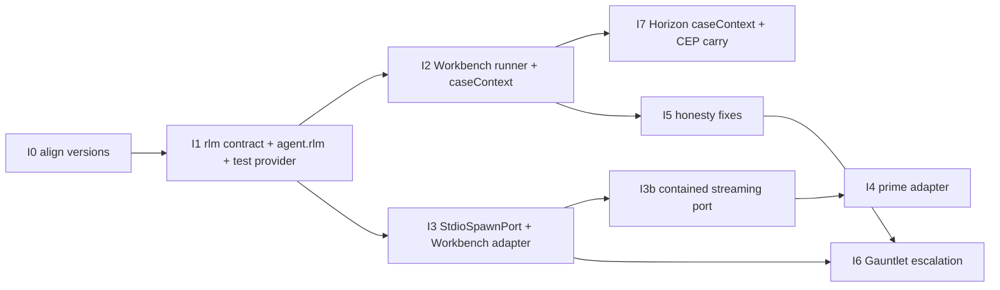

# F — Minimal implementation sequence (revision 2)

Corrected after the design critic ([`egm-review/design-critic.md`](egm-review/design-critic.md)).
The first revision assumed a `native` RLM runner in Cognate that does not exist and a spawn
extraction that would have moved six app-owned stores; both are gone.

## I0 — Align the Cognate version line (prerequisite, no feature)

* **Prior state**: none.
* **Boundary**: `cognate-workbench/package.json` + `bun.lock`; `Horizon/package.json` +
  `bun.lock`.
* **Newly possible**: later increments are observable at runtime (`A5`).
* **Removed**: stale 0.8.0 installs.
* **Verify**: `bun install && bun test` green in both repos; assert `CaseContext` is exported;
  record the resolved versions in the build log. **A release step is part of this increment**: the
  two apps consume published `@godspeedai/cognate-*` packages, so I1's new types are unreachable
  from Workbench until a Cognate version carrying them is tagged and pinned. I1 therefore ends with
  a tagged release and I2 pins it; a workspace link is not an acceptable substitute (`I0`).
* **Unsupported**: nothing new. If 0.10.0 breaks Workbench, stop here and file the breakage; do
  not paper over it with path aliases.

## I1 — `rlm` contract, `agent.rlm`, and a test provider (first vertical slice)

* **Prior state**: I0.
* **Boundary**: `cognate/packages/runtime-api/src/rlm.ts` (types + `StdioSpawnPort`),
  `cognate/packages/runtime-bun/src/rlm.ts` (component, registry, `agent.rlm`),
  `index.ts` export.
* **Newly possible**: a run can invoke a provider-backed child run, inspect it, cancel it, and
  reconcile an `unknown`; the capability facts are reported, not inferred. The first slice is
  proven with an in-memory **test provider** shipped only in tests.
* **Removed**: nothing. `subagent.start` is untouched; this is a typed sibling, not a second
  scheduler.
* **Verify**: admitted→running→completed; terminal stability; idempotent cancel; `unknown` on a lost
  child opens an `ambiguous-invocation` continuation and blocks retry; the parent's wait on
  `rlm-invocation:<id>` is resolved by the RLM component when the child run ends (the same
  continuation pattern `team_delegate` already uses, not a polling loop); top-level invocation
  refused; authority non-subset refused; depth refusal; numeric limit without `reservationRef`
  refused; `prime`-token absence; vocabulary parity with `agent_runner.rs:162-229`.
* **Unsupported**: no production provider exists, and Cognate does not claim RLM capability until
  I4 lands one. This is stated in product copy and in `rlm.providers` (empty array).

## I2 — Workbench runner selection and case context

* **Prior state**: I0, and I1 **released and pinned** (not a workspace link).
* **Boundary**: `src/experts/types.ts` (`runner`, `caseContext`), `src/experts/service.ts`
  (freeze both into the execution snapshot; `assertedBy` recorded), `src/agents/agentCoding.ts`
  (Expert branch calls `rlm.invoke` when a provider runner is frozen in), `src/experts/bridge.ts`
  (map `unknown`).
* **Newly possible**: a Team or Expert configured with a provider executes its Assignment through
  it; with `runner:none`, behaviour is the current path byte-for-byte.
* **Removed**: nothing.
* **Verify**: J3 and J4; existing expert/team suites unchanged; a Specialist with a provider
  still cannot delegate; `runner:none` path produces no `rlm.*` invocation.
* **Unsupported**: no provider package yet, so only `none` is selectable in a shipped build.

## I3 — `StdioSpawnPort` and the Workbench implementation

* **Prior state**: I1; `feat/capability-runtime-t4a` (`bbe6c73`) merged or checked out as the
  working base for this increment.
* **Boundary**: the port in `runtime-api`; a Workbench adapter that wraps the **existing**
  `src/capabilities/execSpawn.ts` (posture record, ledger, slots, `beforeIntent` all stay where
  they are). No store moves into Cognate.
* **Newly possible**: a provider adapter can request a governed long-lived process without
  importing Workbench.
* **Removed**: the ad-hoc stdio handling inside `src/mcp/client.ts` becomes a caller of the same
  port.
* **Verify**: the containment matrix tests still pass unchanged; a contained posture refuses; a
  non-local world refuses `stream-port-unavailable`; win32 refuses `no-process-groups`; a spawn
  intent without a terminal record is reported unresolved on boot.
* **Unsupported**: streaming on any world but `local`, exactly as today.

## I3b — A contained streaming world with a declared reach matrix [R4]

* **Prior state**: I3. Verified feasible on this host with bubblewrap 0.13.1 (D8.3).
* **Boundary**: a new execution-world kind `contained-streaming` and its spawn implementation:
  `bwrap --unshare-all --unshare-user --disable-userns --new-session --die-with-parent --cap-drop ALL`
  with host-held stdin/stdout pipes, a `workspace-ro` or `workspace-rw` bind, a tmpfs `/tmp`, a
  process group, and (when the provider needs a model endpoint) exactly one bind-mounted unix
  socket to a host egress proxy. The provider's `portGovernance` declaration is produced here.
* **Newly possible**: a provider can run in the posture governance requires, with reach no wider
  than the parent's grant, without depending on the provider to restrict its own tools.
* **Removed**: the assumption that streaming requires an uncontained local world.
* **Verify**: live stdio round-trip; network unreachable except the bound socket; a read-only grant
  cannot write the workspace; `kill` terminates the group; the fs diff is recorded as evidence; a
  provider that declares `network:"proxied"` with no proxy is refused `rlm-egress-uncontrolled`.
* **Unsupported**: subprocess counting (the matrix reports it not-enforced for every kind), seccomp
  profiles, and semantic exfiltration control (a proxied provider can still send workspace content
  to its model; the port names and records the destination, it cannot judge the payload).

## I4 — Prime adapter (Route B when I3b lands, Route A otherwise)

* **Prior state**: I2 (consumer), I3 (transport), owner answers O1 (package vs sidecar) and O2
  (whether I3b is in scope). With I3b, the adapter declares `portGovernance` and can be admitted
  under governance; without it, only an ungoverned `local` port exists.
* **Boundary**: `cognate/packages/rlm-prime/*` implementing an **ACP client** (`initialize`,
  `session/new`, `session/prompt`, `session/update`, `session/cancel`) over the `StdioSpawnPort`.
  [R5] This supersedes extracting Gauntlet's TypeScript host: ACP is a public spec, verified against
  `prime-agent` 0.10.2, and it removes the `focus`/`topology`/`affordance` import closure. Gauntlet's
  host is left untouched; only its spawn validation is reused as prior art.
* **Newly possible**: `rlm.providers` lists a real provider and a Team can select it. With I3b it
  runs in a contained streaming port with a declared reach matrix; without I3b it runs only in an
  ungoverned local host. The adapter reports
  `toolPolicy:"unattested"`: resolve pass G1 row 1 found no tool allowlist in `prime-agent` 0.10.2
  (no CLI flags, no settings key, zero binary string hits). It is usable only where the operator has
  explicitly accepted an unattested provider on an `uncontained-local` host.
* **Removed**: Gauntlet's duplicate TS protocol copy (conditional on it importing the package).
* **Verify**: ACP handshake fixture (`initialize` → `agentCapabilities`, `session/new` → `sessionId`);
  a recorded `tool_call` becomes an evidence claim; `session/cancel` stops work; the `prime`-token
  test; `toolPolicy:"unattested"` refused for any narrowed-authority run without Route B; version
  range refusal; J4 with a real binary in an opt-in suite. Do not add a `bridge-only` claim; the
  evidence does not support one.
* **Evidence basis**: `prime-agent --mode acp` answered `initialize` with
  `agentInfo.version 0.10.2` and `sessionCapabilities.close`, and `session/new` returned a live
  `sessionId` with model `configOptions`.
* **Unsupported**: any host without process groups; any use whose required reach the port cannot
  enforce; and semantic exfiltration control even when proxied. These are refusals, not
  degradations.

## I5 — Honesty fixes (small, independent)

* **Prior state**: only `main`.
* **Boundary**: (a) `settlementScope`/`receiptRef` on `world.settled` and
  `workbench.settlement.recorded`; (b) add the governed settlement family to
  `OBSERVED_EVENT_TYPES` so it reaches RealityTrace at all — with the cost of one SXR ingest
  subprocess per settled operation recorded in the change; (c) `experts.restore` with the
  semantics in `D3`; (d) per-id idempotent seed replacing the `seed:v1` receipt lock.
* **Newly possible**: a downstream reader distinguishes local from governed, and governed
  settlement is no longer invisible to the evidence stream; an operator restores the baseline;
  `affordance.field` and the `OPERATIONS` catalogue make move selection reachable (G14); the
  legacy `pluginRegistry` and its consumers are removed once the inventory is empty (G16).
* **Removed**: the permanent seed lock.
* **Verify**: J9 and J12; absence of `settlementScope` reads as `local`; a governed settlement
  produces an observation with `receiptRef`.
* **Unsupported**: no automatic restore at boot (deliberate).

## I6 — Gauntlet escalation

* **Prior state**: I3 (spawn), I5 (labels).
* **Boundary**: new `src/capabilities/escalate.ts`; `src/cognitive/criterion.ts` (projection);
  one operator action.
* **Newly possible**: an explicit escalation with a frozen reference, a recorded spawn intent and
  Gauntlet's own terminal state.
* **Removed**: nothing.
* **Verify**: J6 and J7; `gauntlet run --config` is the invocation (there is no `--project`); exit
  code 0/1/2 is authoritative; stdout is archived as `reportRef`; reference tampering makes
  Gauntlet refuse and Workbench surfaces that refusal; `runners.default` must be operator-named
  and Workbench refuses to choose it; no Workbench settlement event is produced.
* **Unsupported**: governance mode (posture), and projects without a runner.

## I7 — Horizon case context and CEP carry

* **Prior state**: I0, I2, `feat/wp23-assignment-binding` (`668f686`) merged. This increment also
  owns the `caseAssignmentId` link from a Workbench Assignment to a Cognate CaseAssignment (G5).
* **Boundary**: `Horizon/src/capabilities/handoff.ts`, `Horizon/src/adapters/workshop.ts`.
* **Newly possible**: a handoff reaches a Workbench run with world identity, an explicit
  corroboration flag, and recorded attribution.
* **Removed**: the always-empty `settlement_criteria`.
* **Verify**: J8 and J14; refusal for an evaluated case without `worldRef`; `worldCorroboration`
  is `verified` only when a registry check ran, else `asserted`; `assertedBy` is recorded and
  never used as a refusal.
* **Unsupported**: a CEP crossing into Gauntlet (it takes the frozen reference instead).

## Why this order

I1 is Cognate-only and does not pretend to be an RLM capability; it proves the contract with a
test provider. I2 proves the convergence claim against a real consumer without adding a provider
dependency. I3 declares a port and adapts code that already exists, instead of moving app stores.
I4 adds the first real provider, honest that it works only ungoverned. I5 removes ambiguity on
its own. I6 and I7 are the optional integrations and come last.

## What must NOT happen during implementation

* No new scheduler, work queue, persisted assignment store, or second run identity.
* No `native` provider resurrected to make the first slice look stronger.
* No Prime identifier in `runtime-api`, capability ids, CEP profiles, or DomainForge semantics.
* No weakening of the one-Orchestrator check, the authority intersection, the review independence
  check, or the posture refusal to make a test pass.
* No silent fallback from a configured provider to `none`.
* No re-freezing a Gauntlet reference from inside the run it governs, and no Workbench choosing
  `runners.default`.
