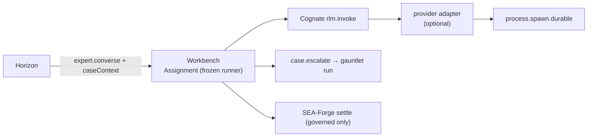

# Cognate RLM Convergence and GodSpeed Composition

* **Author:** EGM design agent, for the GodSpeed AI owner
* **Status:** Proposed (reviewed; see [`egm-review/`](egm-review/))
* **Date:** 2026-11-19

## Overview

Cognate gains one first-class, provider-independent recursive-execution capability, delivered
as ordinary Cognate runs. Cognate Workbench's existing Experts, Teams and Assignments are the
only agent hierarchy that consumes it, so Workbench stays usable alone. Gauntlet remains an
optional controller reached through one governed-spawn seam with a frozen reference. Horizon
keeps its single `expert.converse` seam and now carries case and world identity on it. No new
orchestrator, case engine, envelope schema or authority is introduced.

## The Problem

The ecosystem already implements most of the required behaviour, but three things are missing
or mislabelled. There is no recursive-execution contract anywhere (verified by search across
Cognate, CEP, DomainForge, SEA-Forge and RealityTrace). Cognate's only process port is
buffered, so it cannot host a live external harness. And the identity of a case (its world and
semantic revision) is dropped at every Workbench and Horizon boundary, while local acceptance
and governed settlement are distinguishable in events but not in the observation stream
downstream.

The risk of "just add RLM" is that it becomes a fourth child-execution mechanism beside
`subagent.start`, `team.delegate` and Gauntlet's invocation graph, with its own identity,
authority, budget and recovery. This design refuses that: the RLM executes an *existing*
Assignment, under the *existing* principal, with the *existing* authority intersection and
budget reservation, and its identity is the Assignment's.

## Goals

* One `rlm.*` capability contract in Cognate; Prime Agent is an optional adapter, never a
  semantic dependency.
* Experts and Teams use it transparently; a Specialist can investigate without becoming an
  Orchestrator; a standalone Expert works with no provider installed.
* Workbench standalone behaviour is unchanged when every optional product is absent.
* A recoverable built-in Expert/Team baseline under operator control.
* One Workbench→Gauntlet escalation seam with a frozen reference and no second settlement.
* Horizon reuses its existing call and preserves CEP identity; local vs governed settlement is
  readable from payloads alone.
* A consolidation plan that removes at least four duplicated mechanisms.

## Non-Goals

* No new agent framework, scheduler, queue, case engine, or universal envelope.
* No DomainForge schema change, no new CEP profile, no SEA-Forge authority change.
* No mandatory Prime, Gauntlet, Horizon, DomainForge, SEA-Forge or RealityTrace dependency.
* No Windows/macOS containment implementation; unsupported containment must refuse.
* No backwards compatibility for superseded internal interfaces.
* No implementation in this phase.

## Open Questions

Answered ones are removed; what remains is in [`G`](G-residual-uncertainty.md) §2 and blocks a
specific increment only.

1. Can Prime be launched with only bridged tools? (blocks I4; the largest unproven dependency)
2. Is a new optional package acceptable, or must the adapter be a Gauntlet-owned sidecar?
   (blocks I4 packaging)
3. Does the owner accept that providers are refused under governance until a containment mechanism
   admits them? (this design assumes yes; the alternative is a containment project, not a
   convergence one)
4. Is the pre-existing self-approval hazard of `uncontained-local` hosts acceptable as documented,
   or does it block local provider use entirely?

## Critical User Journeys

Fourteen journeys with observable pass/fail and negative tests live in
[`E`](E-acceptance-journeys.md). The four that decide whether this design is real:

* **J1** Workbench alone, with every optional binary removed.
* **J4** the same assignment run natively and through a provider, with truthful capability
  facts in both cases.
* **J7** a long-horizon escalation that cannot mark a case settled.
* **J11** a killed external invocation that is reconciled, never blindly retried.

## Technical Plan (Architecture)

The seven views are in [`C`](C-target-architecture.md); the contracts are in
[`D`](D-minimal-contracts.md). In one paragraph: a provider registry and four capabilities
(`rlm.providers`, `rlm.invoke`, `rlm.inspect`, `rlm.cancel`; ambiguous outcomes reuse the existing
`run.invocation.reconcile`)
live in Cognate; `rlm.invoke` starts exactly one child run of `agent.rlm` *for* an existing
Assignment (the Assignment's own `runId` is unchanged), under a principal derived from the parent
run, with a caller-attested authority set re-checked at the seam and the caller's own budget
reservation; there is **no built-in provider** — when none is installed `rlm.providers` is empty
and Experts use their ordinary loop; external providers are adapters that must attest a tool
policy and are reached through a `StdioSpawnPort` the host application implements; Workbench
adds a `runner` to the frozen execution snapshot, a `case.escalate` capability and an
`experts.restore` command; Horizon adds `caseContext`/`assertedBy` to its existing call.

## Alternatives Considered

The nine alternatives and why each was refused are in
[`concepts_brief.md`](concepts_brief.md) and the fifteen per-decision trade-offs in
[`DECISION-LOG.md`](DECISION-LOG.md). The three that a reviewer will reasonably prefer:

### Alternative A: RLM controller inside Workbench
* **Pros**: one owner, no new Cognate package, the Expert loop is already there.
* **Cons**: Horizon and Gauntlet each grow a copy; Workbench becomes the platform; the
  "optional integration" property inverts.
* **Rejected because**: three consumers need the same mechanism, and only one of them owns
  execution today.

### Alternative B: bridge Gauntlet's Rust `AgentRunner`
* **Pros**: one canonical Prime protocol; Rust is already hardened and tested.
* **Cons**: no FFI/WASM surface exists; a sidecar adds a process boundary, a wire format and
  per-platform packaging for the same behavioural result the TS host already has.
* **Rejected because**: it is more new code than the extraction, not less.

### Alternative C: a new CEP profile for execution
* **Pros**: expresses semantics the existing profiles may not cover.
* **Cons**: an eighth source of truth; SEA-Forge validates seven corroborated fields today; the
  gap is a field, not a profile.
* **Rejected because**: `G` records the field-level gap instead, and a CEP change proposal is
  cheaper and reviewable.

## Non-Functional Requirements

* **Security**: no prompt-only enforcement **where the effect happens** — Workbench's
  `authorizeCapabilityOp` remains the real grant, and this design adds no second one; the RLM seam
  re-checks that a request is a subset of the caller's attested set and records it as attested.
  Provider tool policy is declared and operator-authorised, which is attribution, not proof.
  Containment is refused where unenforceable. Under SEA-Forge governance an external provider is
  admitted only through a governed port (contained streaming, a reach matrix no wider than the
  parent's grant, one declared egress channel, fs-diff evidence — D8); otherwise it is refused. No
  secret in argv, records or logs.
* **Payment honesty**: unknown price never zero; a ceiling with unknown prices refuses.
* **Performance**: provider probing is lazy and bounded; boot must not block on a missing
  binary; no new polling loop (events and continuations already exist).
* **Rollout**: I0 is reversible; I1–I2 are behind "no runner configured" (`runner:none`); I4 ships as an
  optional package; I6/I7 are separable and can be deferred.
* **Rollback**: delete the provider entry to return to the ordinary loop; delete the escalation record to
  return a case to local work; no data migration is required.

## Additional Resources

* [`A`](A-actual-state.md), [`B`](B-gap-and-convergence-ledger.md),
  [`E`](E-acceptance-journeys.md), [`F`](F-implementation-sequence.md),
  [`G`](G-residual-uncertainty.md), [`recon/`](recon/).
* CEP profiles: `cep/schemas/profiles/godspeed/` (7 × `1.0.0`) ‡.
* Gauntlet port semantics: `crates/gauntlet-ports/src/agent_runner.rs:441-484`.
* Cognate run/continuation contracts: `packages/runtime-api/src/types.ts:257-322`.

## Future Improvements

* **The idea**: automatic reconciliation when a provider offers a trustworthy result contract.
  Not now: it changes retry semantics and needs provider-by-provider proof.
* **The idea**: a real platform sandbox for macOS/Windows so the provider path is usable there.
  Not now: it is a containment project, not a convergence one.

## Detailed Implementation Plan

See [`F`](F-implementation-sequence.md) for the eight increments with boundaries, removals,
verification and unsupported behaviour. Target files per increment are named there; the
contracts they must satisfy are in [`D`](D-minimal-contracts.md).

### Verification Plan

* Cognate: `bun run test` in `packages/runtime-bun` and `packages/runtime-api`; new tests for
  admission, terminal stability, cancel idempotency, `unknown`, authority/depth/budget refusals,
  and the `prime`-token absence rule.
* Workbench: `bun run verify` (typecheck + `bun test`), plus the existing expert/team/E2E suites
  unchanged; new journeys J1–J5, J9–J12.
* Horizon: existing suite plus J8 and the `assertedBy` recording test.
* Gauntlet: its own `cargo test` plus the protocol fixture suite shared with the extracted
  adapter; `just proof` where SEA-Forge evidence is touched.
* Cross-repo: J14 fixture (DomainForge envelope → SEA-Forge validator) and J7 (reference
  tamper refusal).

*Drafted with EGM*
