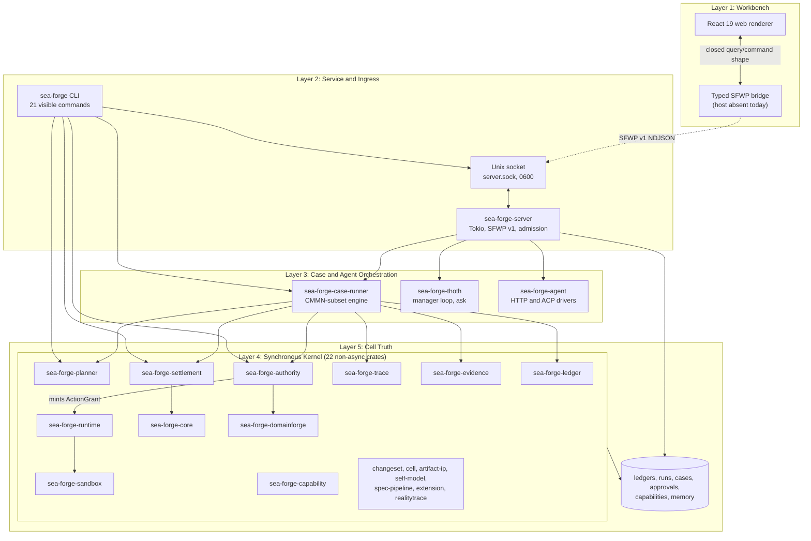
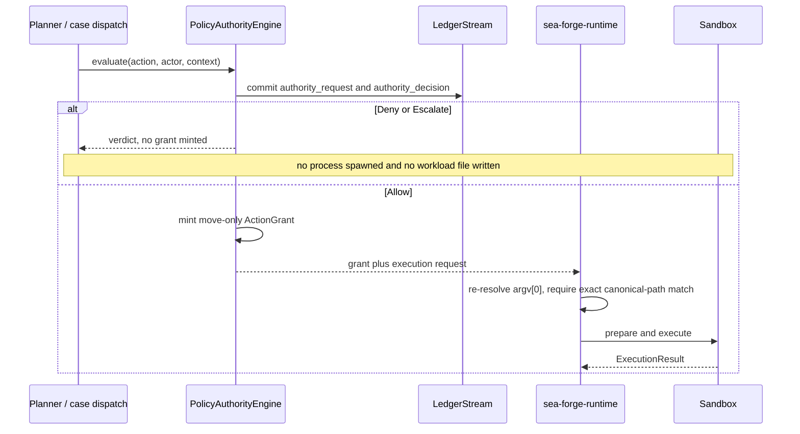

# SEA Forge Canonical Architecture

> **The architectural shape of the SEA Forge governed capability-execution kernel.**  
> Covers the Rust workspace, SFWP edge, synchronous kernel boundary, and the current Workbench renderer. The Tauri desktop host was removed on 2026-10-13.

---

## 1. System Overview

SEA Forge is a local, governed execution system built around **cases**. It turns intent into typed plans, evaluates authority before workload effects, executes allowed operations inside OS sandboxes, records append-only trace and evidence, settles declared outcomes independently of process exit status, and derives capability memory from settled results.

### Status and authority

* **Normative source:** implementation code and conformance tests (`just proof`, `just ci`, `just crate-test <crate>`).
* **Rust workspace:** 24 crates. Two are async edge crates (`sea-forge-server`, `sea-forge-agent`); the other 22 are synchronous.
* **Workbench:** a Bun workspace containing a React 19/Vite web renderer. The Tauri `src-tauri` shell was removed; the renderer still calls `@tauri-apps/api`, so its real backend bridge is currently absent (see [Workbench](subsystems/workbench-desktop.md)).
* **Platforms:** Linux is primary (Landlock ABI v1–v6); macOS is secondary (Seatbelt `sandbox-exec`).

---

## 2. Architectural Layers



### Layer 1 — Workbench

The renderer owns route navigation, form drafts, TanStack queries, XState interaction machines, and the G1–G10 operator pre-flight guards. It has no direct filesystem, socket, or SQL access. The guards return `passed`, `failed`, `indeterminate`, or `not_applicable`; they are not the enforcement point. Enforcement remains server-side.

The former Tauri host owned the Unix-socket client and exposed the closed `SfwpQuery`/`SfwpCommand` bridge. That host is gone. The renderer still imports `@tauri-apps/api`; without a host, the bridge is a documented gap rather than a working data path.

### Layer 2 — Service and ingress

* **`sea-forge-server`:** long-running Tokio service on an owner-only Unix socket. Implements SFWP v1, request admission, correlation idempotency, live events, identity binding, and agent/MCP/Postgres edges.
* **`sea-forge-cli`:** scriptable operator surface with 21 visible top-level commands. Synchronous; it does not depend on Tokio. See [CLI reference](reference/cli-command-reference.md).

### Layer 3 — Case and agent orchestration

* **`sea-forge-case-runner`:** synchronous CMMN-subset lifecycle primitives, stage transitions, sentries, and shared mediation used by CLI and server.
* **`sea-forge-thoth`:** manager-loop judgment/proposals and typed `ask` over the self-model, with separation-of-duty checks where approvals are involved.
* **`sea-forge-agent`:** governed Anthropic, OpenAI-compatible, and ACP transports; brokered tool calls; sealed transcripts. Async because provider and ACP I/O are async.

### Layer 4 — Synchronous kernel

Twenty-two crates contain deterministic governance and execution logic without an async runtime or HTTP client. They are: `sea-forge-core`, `sea-forge-domain`, `sea-forge-planner`, `sea-forge-authority`, `sea-forge-sandbox`, `sea-forge-runtime`, `sea-forge-trace`, `sea-forge-evidence`, `sea-forge-settlement`, `sea-forge-capability`, `sea-forge-ledger`, `sea-forge-domainforge`, `sea-forge-spec-pipeline`, `sea-forge-cell`, `sea-forge-artifact-ip`, `sea-forge-self-model`, `sea-forge-extension`, `sea-forge-cli`, `sea-forge-changeset`, `sea-forge-realitytrace`, `sea-forge-case-runner`, and `sea-forge-thoth`.

Twenty-two, not nineteen: the CLI, changeset, and realitytrace crates were omitted from earlier counts. Tokio lives only in `sea-forge-server` and `sea-forge-agent`.

### Layer 5 — Cell truth

Append-only JSONL journals and hash-chained ledgers hold authoritative state. SQLite indexes, active-policy mirrors, and authority decision views are rebuildable projections.

---

## 3. Load-Bearing Invariants

| ID | Formulation | Consequence |
|---|---|---|
| **AUTH-01** | **Authority precedes workload effects** | No process is spawned and no workload payload is written without a committed `Allow`. **Implementation note:** intent runs create their control-plane scaffolding (`run_dir`, `workspace/`, `artifacts/`) before authority evaluates. The directories are empty setup, not workload writes, but the stricter formulation "no workspace directory before Allow" is not met by the current code. |
| **AUTH-02** | **One authority fabric** | CLI, server, and Workbench protected paths use the same policy engine and decision vocabulary. There is no second permission system. |
| **DOM-01** | **Settlement is independent of exit status** | `exit_zero` is one basis token. Acceptance requires the committed criteria to be satisfied by evidence. |
| **DOM-02** | **Every activation is an episode** | A settled run has plan, authority, trace, evidence, settlement, and semantic-envelope records. |
| **DOM-03** | **DomainForge candidate precedes authority** | When a domain model is bound, it is resolved before evaluation. DomainForge proposes semantics; authority decides. |
| **BUILD-01** | **Synchronous kernel boundary** | 22 non-edge crates must not depend on Tokio, async runtimes, or HTTP clients. Tokio is allowed only in `sea-forge-server` and `sea-forge-agent`. |
| **DATA-01** | **History is append-only; views are rebuildable** | Source truth is JSONL and hash-chained ledgers. SQLite and JSON caches can be rebuilt. |
| **DATA-02** | **Canonical run locator** | Flat (`runs/<id>`) and case-owned (`cases/<case>/runs/<id>`) layouts resolve through one locator. |
| **DATA-03** | **Request ids are idempotency keys** | A repeated request id returns the stored outcome; a changed payload with an existing id fails closed. |
| **GEN-01** | **Generated zones are protected** | Generated code zones are not hand-edited; guards reject unchecked modification. |
| **OPS-01** | **Fail-closed configuration** | A present but invalid `server.yaml` blocks startup. An absent file yields defaults. Reload swaps a validated snapshot for future dispatches; root and socket stay fixed. |

---

## 4. Detailed Views

### 4.1 Authority and the ActionGrant seam



`ActionGrant` is move-only: not cloneable and not serializable. It carries the action, run and item identity, workspace and artifact boundaries, timeout, environment key set, sandbox class, a boundary map with a reserved TCP-port path that the current policy schema does not expose, expiry, action hash, and the canonical executable path verified at decision time.

The runtime re-resolves `argv[0]` immediately before spawn and requires exact canonical-path equality with the grant. It does **not** compare a stored SHA-256 of the executable. Artifact content hashing is a separate evidence concern.

### 4.2 Runtime topology

```text
Host
├── sea-forge-server (PID A)
│   ├── binds <root>/server.sock (0600)
│   ├── holds <root>/server.sock.lock
│   ├── admission: max_concurrent_runs active, fixed 8-waiter queue
│   └── SFWP v1 dispatch; spawn_blocking for synchronous kernel work
│
├── Workbench renderer (browser)
│   └── React 19 UI; typed host bridge absent today
│
└── sandboxed children (PIDs C1..Cn)
    ├── spawned only after an Allow grant
    ├── Landlock (Linux) or Seatbelt (macOS)
    └── writes confined to run workspace/ and artifacts/
```

### 4.3 Truth versus projections

| Role | Paths | Recovery |
|---|---|---|
| **Truth** | `ledgers/`, `cases/**/case-events.jsonl`, `runs/**/{trace,evidence}.jsonl`, `approvals.jsonl`, `capabilities.jsonl`, `memory/items.jsonl` | Primary. Verified by ledger hashes/MMR where applicable. |
| **Materialized views** | `authority/active-policy.json`, `authority/decisions.jsonl`, `authority/audit.jsonl`, run `authority.json` | Rebuilt from committed ledger entries. |
| **Search index** | `memory/index.sqlite` | Derived from `memory/items.jsonl`; rebuild with `sea-forge memory rebuild`. |
| **SFWP views** | in-memory query results | Folded from durable events per request. |

### 4.4 Trust boundaries

1. **Client to server:** socket mode `0600`, plus kernel-reported peer uid (`SO_PEERCRED`) mapped through `identity.bindings`. A client-supplied actor claim is checked, never trusted by itself.
2. **Renderer to host:** the closed `SfwpQuery`/`SfwpCommand` shape is the intended boundary. No generic `invoke_backend(method, arbitrary_json)` escape hatch. The host implementation is currently missing.
3. **Kernel to child:** Landlock/Seatbelt filesystem confinement and denied network by default. The runtime has a reserved TCP-port grant path, but the current policy schema does not expose it. Ambient environment is stripped; children receive declared keys only.
4. **Credentials:** secrets are not written to argv, trace, evidence, or ledgers. Agent credentials are referenced by environment name; database session passwords stay in memory and the workload environment.

---

## 5. Subsystem Guides

* [Kernel pipeline](subsystems/kernel-pipeline.md)
* [Authority fabric](subsystems/authority-fabric.md)
* [Sandbox and runtime](subsystems/sandbox-runtime.md)
* [Settlement and evidence](subsystems/settlement-evidence.md)
* [Integrity ledger](subsystems/integrity-ledger.md)
* [Capability memory](subsystems/capability-memory.md)
* [DomainForge boundary](subsystems/domainforge-boundary.md)
* [Server and SFWP](subsystems/server-sfwp.md)
* [Thoth and agents](subsystems/thoth-agent.md)
* [Workbench](subsystems/workbench-desktop.md)
* [Spec pipeline and artifact IP](subsystems/spec-pipeline-ip.md)
