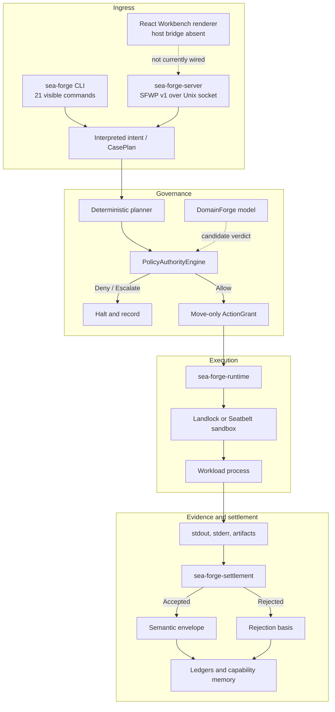

# SEA Forge Documentation Home

> **A local governed capability-execution kernel organized around cases.**
> Authority before workload effects, sandboxed execution, append-only evidence, and settlement that does not trust exit status.

---

## 1. What SEA Forge Is

SEA Forge turns a typed intent into a case plan, evaluates authority for each operation, executes allowed operations inside an operating-system sandbox, records trace and evidence, settles the declared outcome independently, and promotes accepted results into capability memory.

It is built for the gap between "the command exited 0" and "the declared result actually happened." An agent can exit cleanly after writing nothing, writing to the wrong place, or failing an internal assertion. SEA Forge treats process termination as evidence, not as success.

The system is local-first. A cell is one root directory with one owner-only Unix socket, and it can be driven by the CLI today. The server exposes SFWP v1 to clients. The Workbench renderer exists, but its Tauri host was removed on 2026-10-13 and its real backend bridge is currently missing. See [Workbench](subsystems/workbench-desktop.md) before relying on the UI.

---

## 2. The Problems It Targets

* **False success.** Settlement requires committed criteria to be satisfied by captured evidence. `exit_zero` is only one basis token.
* **Ambient privilege.** Children do not inherit the parent environment. They receive declared variables, filesystem confinement, and denied network by default. The runtime has a reserved TCP-port grant path, but the current policy schema does not expose it.
* **Mutable history.** Authoritative state lives in append-only JSONL and hash-chained ledgers. SQLite and JSON views are rebuildable projections.
* **Shell-string intent.** Intent is interpreted into typed operations. The planner does not interpolate arbitrary text into `sh -c`.
* **Unaccountable denials.** A denied episode still records authority decisions, a halt, and a settled `Rejected` outcome instead of disappearing.

---

## 3. The System in One Picture

The arrow from Workbench to server is dashed on purpose. The renderer still imports `@tauri-apps/api`; without a Tauri host there is no working transport.

---

## 4. Eight Concepts to Start With

1. **Cell.** One root directory (`SEA_FORGE_ROOT`) that owns `server.sock`, cases, runs, ledgers, approvals, capabilities, and memory. See [Cell Contract](CELL_CONTRACT.md).
2. **Intent.** A bounded statement of desired action, at most 500 characters. It is interpreted into a known pattern before planning. Unknown intent fails with exit `2`.
3. **Case and plan.** A CMMN-subset structure of stages, milestones, tasks, and sentries. `CasePlan` is the durable plan; a run is one activation of an item.
4. **Run or episode.** A concrete execution (`run_<timestamp>_<hex>`) with plan, authority, trace, evidence, settlement, and semantic-envelope records.
5. **ActionGrant.** A move-only Rust value minted only on `Allow`. It carries boundaries, identity, timeout, environment keys, sandbox class, and the canonical executable path. The runtime consumes it to spawn.
6. **Settlement.** Evaluation of a claim against execution evidence and workspace state. The result is a status plus machine-readable basis tokens such as `authority_allow`, `exit_zero`, or `required_artifact_missing:model.sea`.
7. **Integrity ledger.** Per-stream append-only JSONL with ULID ordering, hash chains, Merkle Mountain Range proofs, Ed25519 checkpoints, and optional witness quorums.
8. **SFWP.** The versioned NDJSON protocol over the cell's Unix socket. It carries closed queries and commands, not a generic backend escape hatch. See [SFWP reference](reference/sfwp-protocol-reference.md).

---

## 5. A Representative Journey

`sea-forge run --intent "generate a .sea model"` currently does this:

1. The CLI loads policy, interprets the intent as `Demo`, and validates attribution.
2. It creates the root, `runs/`, `cases/`, the run directory, `workspace/`, and `artifacts/`.
3. The planner builds a two-operation plan using the current executable: write `model.sea`, then run `<exe> validate model.sea`.
4. It commits settlement criteria: exit zero, `model.sea` required, stdout must contain `sea-forge: model valid`.
5. It commits intent, plan, identity binding, policy snapshot, and criteria to the ledger.
6. Authority evaluates both operations. Every verdict must be `Allow`; otherwise the run halts and settles without executing.
7. The write is materialized through a grant. The runtime re-resolves `argv[0]` and requires exact canonical-path equality before spawning the validator.
8. The child runs in the selected sandbox with a stripped environment. Output and artifacts are captured with SHA-256 content identity.
9. Settlement checks criteria against the captured evidence. A zero exit with no `model.sea` is rejected.
10. Accepted work produces `settlement.json` and `semantic-envelope.json`, appends to `capabilities.jsonl`, and attempts deterministic memory extraction.
11. The case closes as `Completed`, `Terminated: rejected`, or `Terminated: escalated`. The command exits `0`, `3`, or `4`. Dispatch errors exit `2`; other errors exit `1`.

The control-plane directories exist before authority evaluates. The invariant applies to workload effects: no process is spawned and no workload payload is written without `Allow`. This distinction is deliberate and is recorded in [Architecture](architecture.md) and [CLI Run Lifecycle](workflows/cli-run-lifecycle.md).

---

## 6. Where to Go Next

| Goal | Start here |
|---|---|
| Understand the conceptual model | [Mental Model](mental-model.md) |
| Inspect architecture and invariants | [Architecture Overview](architecture.md) |
| Explore a subsystem | [Subsystem Guides](documentation-map.md#3-subsystems-layer-3) |
| Trace one run end to end | [CLI Run Lifecycle](workflows/cli-run-lifecycle.md) |
| See the run visually | [Governed Run Explorer](explainers/governed-run-explorer.html) |
| Understand design trade-offs | [Explanation and Rationale](documentation-map.md#5-explanation--design-rationale-layer-5) |
| Run it yourself | [First Governed Run](tutorials/01-first-governed-run.md) |
| Author policy or configure the cell | [Configuration Spec](reference/configuration-spec.md) and [Policy How-To](how-to/write-authority-policies.md) |
| Look up exact flags or wire APIs | [CLI Reference](reference/cli-command-reference.md) and [SFWP Reference](reference/sfwp-protocol-reference.md) |
| Find where a concept lives in code | [Source Map](source-map.md) |
| Understand the security model | [Landlock Security Model](explanation/landlock-jail-security-model.md) |
