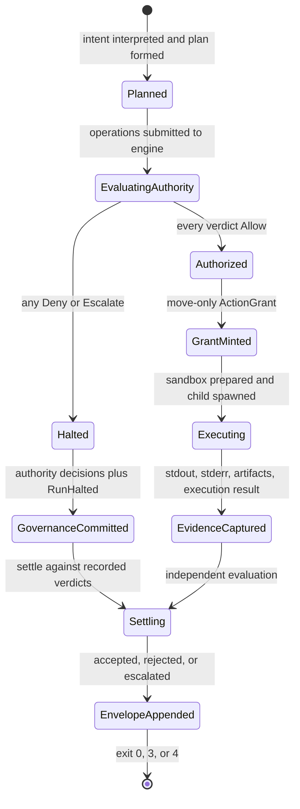

# SEA Forge Mental Model

> **The conceptual foundation of governed capability execution.**  
> Why processes cannot self-certify success · Why authority must precede workload effects · How truth is separated from views.

---

## 1. The Core Paradigm: Governed Execution

Most tooling assumes the process being run is trusted and that `exit 0` means success. In autonomous and regulated environments, both assumptions fail:

* A test runner can execute zero tests, exit 0, and be reported as passing.
* An untrusted tool can inspect its environment, read credentials, and contact an external host.
* A task can claim it created a file while writing nowhere, or writing something else.

SEA Forge treats **execution as untrusted** and **governance as independent**:

```text
Traditional:
Intent (text) -> shell execution -> exit 0 -> "success" (assumed)

SEA Forge:
Intent (data) -> typed plan -> authority decision -> sandbox -> independent settlement -> capability
                              (default deny)        (OS confinement)  (evidence basis)
```

1. A process never declares its own success.
2. Execution requires an explicit grant.
3. Outcomes are evaluated from evidence and declared criteria, not narrative assertions.

---

## 2. Four Pillars

### Pillar 1 — Typed intent and deterministic planning

Intent is not interpolated into a shell. It is represented as data:

```rust
pub struct Intent {
    pub intent_id: String,
    pub summary: String,
    pub actor_id: String,
    pub process_id: String,
    pub created_at: String,
}
```

The planner maps intent to a `CasePlan` of concrete `PlanItem`s. Each item names its operations (`WriteFile`, `ExecuteCommand`, agent tasks), its `SettlementCriteria`, and its required sandbox class (`local`, `jail`, `isolated`, `microvm`, or `openshell`). Planning is deterministic in its logic; ids and timestamps differ between invocations, so do not assume two runs produce byte-identical plan files.

### Pillar 2 — Authority precedes workload effects

Authority is fail-closed:

* Every operation is evaluated before it executes.
* A process is spawned only after an `Allow` for that operation. A workload file is written only through an authorized write path.
* A denial still produces authority decisions, a `RunHalted` trace, and a settlement record. Governance recording is not withheld on denial.
* On `Allow`, the engine mints a move-only `ActionGrant`, which is neither cloneable nor serializable. Runtime execution consumes it by value.

**Current boundary:** an intent run creates its run directory, `workspace/`, and `artifacts/` before authority evaluates. Those directories are empty control-plane scaffolding, not workload effects. The stricter wording "no workspace directory exists before Allow" is therefore not met today. See [Architecture, AUTH-01](architecture.md#3-load-bearing-invariants).

### Pillar 3 — Authority and isolation are distinct

* **Authority decides whether an operation may run.** It evaluates actor, role, bindings, policy, path boundaries, and candidate domain semantics, then returns `Allow`, `Deny`, or `Escalate`.
* **The sandbox enforces boundaries while it runs.** It confines filesystem writes, denies network by default, forwards only declared environment keys, and enforces a wall-clock timeout.

Neither replaces the other. Authorized code can still misbehave; unauthorized code is not made acceptable by isolation.

### Pillar 4 — Settlement is independent of exit status

`exit 0` is one possible basis token, not acceptance. Settlement evaluates the committed criteria:

1. If `require_exit_zero`, did the process exit zero?
2. Are all declared required artifacts present in `workspace/`?
3. If declared, did stdout contain the required literal?
4. If declared, did the evaluator meet its criteria?
5. If batch criteria are declared, does the pass ratio meet the threshold?
6. Are authority verdicts clear of `Deny` and `Escalate`?

Only then does settlement return `Accepted`. A zero exit with a missing artifact is `Rejected` with `required_artifact_missing:<path>`. The settlement engine does not compare artifact SHA-256 digests against expected values; artifact hashes are recorded as evidence, not used as settlement criteria.

---

## 3. Episode Lifecycle



Control-plane scaffolding is created before `EvaluatingAuthority`; the empty directories are not evidence that execution was authorized.

---

## 4. Truth Versus Views

* **Truth:** append-only `.jsonl` journals and hash-chained ledger streams, including failed and denied runs. Records are not updated in place.
* **Views:** `memory/index.sqlite`, `authority/active-policy.json`, authority mirrors, and SFWP query results. These are projections.
* If the memory index is lost, `sea-forge memory rebuild` reconstructs it from `memory/items.jsonl`. The journal remains authoritative.

A projection never overrides a source record.

---

## 5. Where to Go Next

* [Architecture](architecture.md) — crate topology, invariants, trust boundaries.
* [CLI run lifecycle](workflows/cli-run-lifecycle.md) — ordered execution and exit codes.
* [Authority fabric](subsystems/authority-fabric.md) — policy evaluation and grants.
* [Settlement and evidence](subsystems/settlement-evidence.md) — basis tokens and failure semantics.
