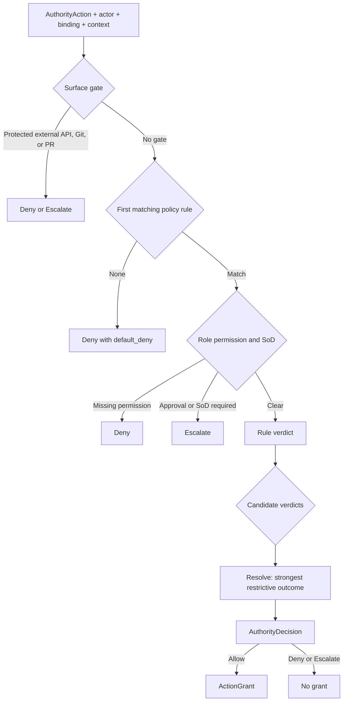

# Subsystem: Authority and Policy

> **One deterministic decision engine for CLI, server, and protected Workbench actions.**
> Governed crate: `sea-forge-authority`

---

## 1. Purpose

The authority engine answers one question before workload effects: may this actor perform this exact action in this context? It evaluates the action against a loaded policy bundle, combines any semantic candidate verdicts, and returns a decision. Only an `Allow` decision can be turned into an `ActionGrant`, and only the runtime can consume a grant to spawn a process.

The engine is deliberately synchronous and deterministic. It has no network client, no async runtime, and no clock-dependent branching except the recorded timestamp and grant expiry.

---

## 2. Responsibilities

* Match an `AuthorityAction`, actor, and context against policy rules.
* Apply policy surface gates for external APIs, Git commits, and GitHub pull requests.
* Combine the local disposition with candidate verdicts from DomainForge and optionally OPA.
* Enforce role permissions and separation-of-duties rules.
* Produce an `AuthorityDecision` with reasons, evidence references, boundaries, and compensating controls.
* Mint a move-only `ActionGrant` from a committed `Allow` decision.

It does not spawn processes, enforce jails, settle outcomes, or authenticate users. Those belong to runtime, sandbox, settlement, and the server's identity layer.

---

## 3. The Decision Path



Surface gates run before ordinary rule matching. For example, an external API host outside `policy_surfaces.external_api.allow_hosts` is escalated if it is a known host, denied if it is unknown. A protected Git path is denied regardless of a matching allow rule.

Ordinary rules are evaluated with `find`, so the **first matching rule wins**. This is not a deny-overrides precedence. A broad allow placed before a narrow deny will allow. Policy authors must order rules deliberately and test them.

A matching rule can still be denied by a missing role permission and escalated by `requires_approval` or a separation-of-duties rule. With no matching rule, the result is `Deny` with reason `default_deny`.

---

## 4. Core Types

### `ActionGrant`

```rust
pub struct ActionGrant {
    action: AuthorityAction,
    run_id: String,
    plan_item_id: String,
    workspace_root: PathBuf,
    artifacts_root: Option<PathBuf>,
    timeout_secs: Option<u64>,
    env_keys: BTreeSet<String>,
    _assurance_ref: Option<String>,
    sandbox_class: String,
    boundaries: BTreeMap<String, Vec<String>>,
    compensating_controls: Vec<String>,
    expires_at: DateTime<Utc>,
    memory_scope: Option<String>,
    _resolved_executable: Option<PathBuf>,
    action_hash: String,
    committed_decision: CommittedRecordRef,
}
```

The grant is not `Clone`, `Copy`, `Serialize`, or `Deserialize`. It carries:

* the exact action and its canonical hash;
* the run, case item, workspace, and artifact roots;
* timeout, environment keys, sandbox class, and boundaries;
* compensating controls and expiry;
* the committed decision reference;
* the canonical executable path resolved at decision time.

The reference to the committed decision matters: a grant cannot be minted from an uncommitted decision.

### `AuthorityEvaluation`

The input context includes actor, `IdentityBinding`, run and case identity, sequence, action, workspace root, evidence references, artifact root, timeout, environment keys, optional DomainForge candidate, optional OPA candidate, and an optional plan-item environment.

### `GovernanceDisposition` and `Verdict`

`Verdict` is the enforced decision: `Allow`, `Deny`, or `Escalate`. `GovernanceDisposition` adds `Boundary` and `Degraded` for resolution and reporting. `Degraded` only survives resolution when `allow_degraded` is set and compensating controls are present; otherwise it becomes `Deny`.

---

## 5. Executable Identity

The engine records the canonical path of `argv[0]` in the grant. The runtime re-resolves `argv[0]` immediately before spawn and requires exact canonical-path equality with that recorded path.

There is no stored SHA-256 of the executable in the grant and no hash comparison at spawn. A binary replaced at the same path between decision and spawn is not detected by this check. Artifact SHA-256 values are evidence about outputs, not executable identity. Do not describe this as TOCTOU-proof binary hashing.

---

## 6. Ledger Commitments

Before execution, the CLI commits:

1. `authority_request`, carrying the actor, action, and context.
2. `authority_decision`, carrying the verdict, matched rule, reasons, policy bundle hash, action hash, and identity binding hash.
3. `authority_evidence`, when evidence is prepared for the decision.

`authority.json` is a materialized view of the run's committed decisions. `authority/decisions.jsonl` and `authority/active-policy.json` are rebuildable mirrors, not source truth.

---

## 7. Invariants and Failure Modes

* **AUTH-01, authority before workload effects.** No child process and no workload payload without `Allow`. Control-plane directories for an intent run are created before evaluation; that exception is documented in [Architecture](../architecture.md).
* **AUTH-02, one fabric.** CLI, server, and protected paths use the same engine and vocabulary.
* **Fail closed.** No matching rule denies. Missing signing material for required assurance denies. An unresolved identity fails.
* **First match wins.** Rule order is part of policy behavior, not a cosmetic detail.
* **No silent fallback.** A configured candidate engine that is required and unavailable must not be treated as `Allow`.

---

## 8. Source Trail

* [`crates/sea-forge-authority/src/lib.rs`](../../crates/sea-forge-authority/src/lib.rs) — bundle, engine, `evaluate_at`, grant minting.
* [`crates/sea-forge-authority/src/cep.rs`](../../crates/sea-forge-authority/src/cep.rs) — CEP authority transitions.
* [`crates/sea-forge-core/src/types.rs`](../../crates/sea-forge-core/src/types.rs) — `AuthorityRequest`, `AuthorityDecision`, `IdentityBinding`, `Verdict`.
* [`crates/sea-forge-authority/tests/conformance_m0_authority.rs`](../../crates/sea-forge-authority/tests/conformance_m0_authority.rs) — authority conformance.
* [`crates/sea-forge-authority/tests/policy_yaml_strictness.rs`](../../crates/sea-forge-authority/tests/policy_yaml_strictness.rs) — strict policy parsing.
