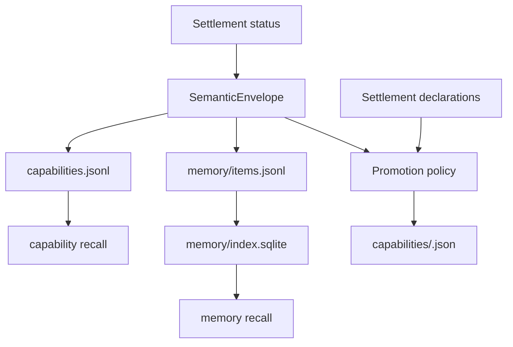

# Subsystem: Capability and Memory

> **Semantic envelopes, promotion records, extracted memory items, and a rebuildable SQLite index.**
> Governed crate: `sea-forge-capability`

---

## 1. Purpose

Capability memory turns a settled run into reusable knowledge. It appends a `SemanticEnvelope` for the run, records promotion state for the capability the run exercised, extracts discrete `MemoryItem` statements, and builds a searchable SQLite FTS index over those items.

The append-only journals are truth. SQLite is a cache.

---

## 2. Responsibilities

* Append envelopes to `<root>/capabilities.jsonl` with `sync_data()` after each write.
* Recall envelopes by text, entity, process, and settlement status while tolerating malformed lines.
* Rebuild `memory/index.sqlite` from `memory/items.jsonl`.
* Evaluate promotion policy and write `<root>/capabilities/<name>.json`.
* Rebuild capability records deterministically from declarations and envelopes.
* Validate extension descriptors used by the capability surface.

It does not settle runs, sign ledgers, or decide authority.

---

## 3. Data Flow



---

## 4. Records

### `SemanticEnvelope`

```rust
pub struct SemanticEnvelope {
    pub version: String,
    pub run_id: String,
    pub case_ref: String,
    pub intent: Intent,
    pub plan_ref: String,
    pub template_ref: Option<String>,
    pub authority_decisions: Vec<String>,
    pub evidence_refs: Vec<String>,
    pub settlement_ref: String,
    pub capability_delta: CapabilityDelta,
    pub attribution: Attribution,
    pub artifact_refs: Vec<ArtifactRef>,
    pub extension_refs: Vec<String>,
    pub projection_refs: Vec<ProjectionRef>,
    pub cell_id: Option<String>,
}
```

`capability_delta` names the attempted capability and the settlement result. `cell_id` is absent for local legacy envelopes and present for federation-origin envelopes.

### `MemoryItem`

```rust
pub struct MemoryItem {
    pub version: String,
    pub memory_id: String,
    pub kind: MemoryKind,
    pub statement: String,
    pub attribution: Attribution,
    pub provenance: MemoryItemProvenance,
    pub dedup_key: String,
    pub created_at: String,
    pub last_confirmed_at: String,
}
```

`MemoryKind` is `Fact`, `Decision`, `Outcome`, or `Preference`. Provenance links run ids and evidence refs. `dedup_key` prevents duplicate insertions during re-indexing.

### `CapabilityRecord`

A record carries counts, status, policy reference and hash, qualifying thresholds, variation and recovery facts, orchestration facts, confidence, contraction reasons, an evidence sample, and `rebuilt_at`.

---

## 5. Promotion

`CapabilityStatus` is `Attempted`, `Demonstrated`, `Proven`, or `Metabolized`.

Promotion is policy-driven. `CapabilityPromotionPolicy` sets minimum declaration count, total evidence weight, maximum regression weight, required variation dimensions, and required recovery disruptions. A record that fails a threshold does not advance; contraction reasons are recorded.

`rebuild_capability` reconstructs a record from declarations and envelopes. The policy snapshot is stored under `<root>/capabilities/policies/<sha256>.json`. The materialized record is `<root>/capabilities/<name>.json`.

---

## 6. Recall and Rebuild

`capability::recall` reads `capabilities.jsonl` with a byte-oriented line scanner. A malformed line increments a `malformed` counter and the scan continues. One corrupt append does not hide every earlier envelope.

`memory::rebuild_index(items_path, index_path, now)` reads items, writes a temporary SQLite file, inserts rows and metadata, commits, runs `integrity_check`, and replaces the target. The CLI exposes this as:

```bash
sea-forge memory rebuild --root <cell>
```

The command reads `memory/items.jsonl` and writes `memory/index.sqlite`. There is no `recall --rebuild` command.

`memory::recall_with_fallback` can query the index and fall back to the source when needed.

---

## 7. Persistence

```text
.sea-forge/
├── capabilities.jsonl
├── capabilities/<name>.json
├── capabilities/policies/<sha256>.json
└── memory/
    ├── items.jsonl
    └── index.sqlite
```

Only the JSONL and promotion source records are durable truth. `index.sqlite` is derived. Deleting it loses no source data; rebuild it from `items.jsonl`.

---

## 8. Invariants and Failure Modes

* **DATA-01.** SQLite is a projection. It is not authoritative.
* **Malformed lines are counted, not fatal.** Recall continues and reports the count.
* **Dedup is keyed.** Re-indexing the same item does not duplicate it.
* **Extraction failure does not reverse settlement.** The run remains settled; extraction is best-effort and logged.
* **Promotion is evidence-weighted.** A single success does not become `Proven` without the policy's counts, variation, and recovery evidence.

---

## 9. Source Trail

* [`crates/sea-forge-capability/src/lib.rs`](../../crates/sea-forge-capability/src/lib.rs) — `append`, `recall`, extension validation.
* [`crates/sea-forge-capability/src/memory.rs`](../../crates/sea-forge-capability/src/memory.rs) — memory append, SQLite index build and recall.
* [`crates/sea-forge-capability/src/promotion.rs`](../../crates/sea-forge-capability/src/promotion.rs) — promotion policy and record rebuild.
* [`crates/sea-forge-cli/src/commands/memory.rs`](../../crates/sea-forge-cli/src/commands/memory.rs) — `memory rebuild`.
* [`crates/sea-forge-core/src/types.rs`](../../crates/sea-forge-core/src/types.rs) — envelope, memory item, capability record.
