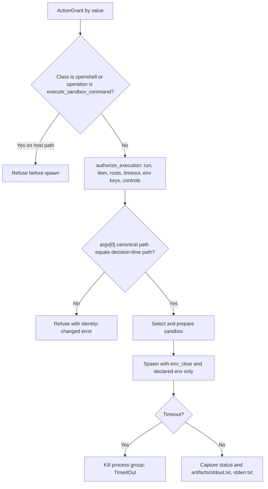

# Subsystem: Sandbox and Runtime

> **Grant consumption, executable identity re-check, OS confinement, process execution.**
> Governed crates: `sea-forge-sandbox`, `sea-forge-runtime`

---

## 1. Purpose

The runtime is the only code path that turns an `ActionGrant` into a child process. It verifies that the grant still matches the request, re-resolves the executable path, selects a sandbox class, prepares the confinement, spawns the child with an explicit argv and a stripped environment, captures output, and enforces a timeout.

The sandbox crate implements the confinement backends. It does not decide whether an action is allowed; authority does that. It also does not decide whether the outcome is acceptable; settlement does that.

---

## 2. Sandbox Classes

```rust
pub enum SandboxClass {
    Local,
    Jail,
    Isolated,
    Microvm,
    OpenShell,
}
```

| Class | Meaning today |
|---|---|
| `local` | Process execution without an OS jail. It is still grant-bound and environment-scrubbed, but it is not a confinement boundary for untrusted work. |
| `jail` | Linux Landlock or macOS App Sandbox confinement. Other platforms refuse. |
| `isolated` | Linux only. One exclusive subordinate host identity per execution (SEC-01). Not available on other platforms. |
| `microvm` | Declared seam. `select_sandbox` returns `unsupported_sandbox_class_error`; there is no backend. |
| `openshell` | Requires a DomainForge projection binding and the `execute_openshell` path. The ordinary host runtime refuses it. |

`select_sandbox` can construct `local`, `jail`, and Linux `isolated`. It refuses `microvm` and bare `openshell`.

---

## 3. Network Posture

```rust
pub enum NetworkPosture {
    Denied,
    AllowTcpPorts(Vec<u16>),
}
```

The posture is derived from the grant's `network` boundary when a grant carries one. The current `0.1` policy schema does not accept `network` in `boundary_constraints`, so policy-authored grants carry no ports and collapse to `Denied`.

Enforcement is TCP-only through Landlock `BindTcp` and `ConnectTcp`. UDP and raw sockets are outside Landlock coverage through ABI v6 and are a documented gap, not a claim of complete network isolation.

---

## 4. Execution Sequence



The identity check compares canonical paths. It does **not** hash the executable. A binary replaced at the same path is a same-instant race rather than a detected modification. The error text says "executable identity changed since the decision", which means the canonical path no longer matches; do not read it as a content-hash proof.

---

## 5. Confinement Details

### Linux Landlock

`JailSandbox` creates a Landlock ruleset, grants reads for the system runtime set and the bound executable tree, grants writes only in `workspace/` and `artifacts/`, sets `PR_SET_NO_NEW_PRIVS`, and calls `landlock_restrict_self` before `execve`.

Landlock availability depends on kernel ABI. Missing or insufficient Landlock is a fail-closed configuration error, not a silent downgrade to `local`.

### Linux Isolated

`IsolatedSandbox` uses a workload identity pool and a helper. It requires Linux and the host prerequisites. The runtime passes the bound executable's parent directory as the one additional read tree, validated so it cannot contain the run.

### macOS App Sandbox

`JailSandbox` runs each execution through a private copy of `sea-forge-jail-launcher`, ad-hoc signed (`codesign -s -`) with `com.apple.security.app-sandbox` and read-write temporary exceptions for the canonical workspace and artifacts trees. The copy execs the workload, so the sandbox is inherited by every descendant. The entitlements carry no network key, so TCP, UDP and DNS are denied. `NetworkPosture::AllowTcpPorts` is refused with `jail_unavailable` because the App Sandbox cannot grant per-port access. The copy lives in the run directory beside the artifacts root and is removed after the run.

`JailSandbox::new()` succeeds only when `/usr/bin/codesign` and the launcher exist next to the running executable. Reads outside the sandbox's default system set are denied. The App Sandbox does not filter environment variables, so the runtime's `env_clear` remains the environment boundary. The backend is covered by `tests/macos_app_sandbox_jail.rs` on a macOS runner. Packaging must ship `sea-forge-jail-launcher` next to `sea-forge`, or the jail is unavailable there.

### OpenShell

`execute_openshell` requires an `execute_sandbox_command`, an `openshell` grant, and a binding whose cell, model hash, policy digest, and image match the request and grant boundaries. It refuses mismatches with `openshell_binding_mismatch` before creating a sandbox. It copies the sandbox workspace back to the result directory. There is no fallback to another class.

---

## 6. Environment and Timeouts

Both local and jail execution call `env_clear()` and then set only the request's declared environment entries. Ambient parent secrets are not inherited. The declared set is whatever the plan and authority grant allowed, commonly `PATH` and `HOME`, but the mechanism is an allowlist rather than a hardcoded pair.

Timeouts use `wait_timeout`. On expiry the implementation kills the process group and reports `TimedOut`. Output is written to `artifacts/stdout.txt` and `artifacts/stderr.txt`; the returned paths are relative artifact paths.

---

## 7. Status Values

`ExecutionStatus` is `Completed`, `SpawnFailed`, `TimedOut`, `SandboxViolation`, or `SuspectedSandboxViolation`.

`SuspectedSandboxViolation` is inferred from child-controlled stderr. The child may have failed for its own reasons, such as a remote 403. It is recorded as suspected, never as a definite jail violation.

---

## 8. Invariants and Limits

* **Exact grant binding.** Run, plan item, workspace, artifacts, timeout, environment keys, and compensating controls must match.
* **One spawn path.** Executables are passed as argv vectors, never interpolated into `sh -c`.
* **No ambient environment.** `env_clear` precedes declared keys.
* **No silent sandbox downgrade.** A missing jail or unsupported class is an error.
* **Identity is path equality, not content hashing.** This is the current boundary; do not market it as binary integrity verification.
* **TCP-only network enforcement.** UDP and raw sockets are out of scope for the Landlock jail.
* **`local` is not a security boundary.** Use it only for trusted workloads.

---

## 9. Source Trail

* [`crates/sea-forge-runtime/src/lib.rs`](../../crates/sea-forge-runtime/src/lib.rs) — `execute`, `execute_openshell`, grant checks.
* [`crates/sea-forge-sandbox/src/lib.rs`](../../crates/sea-forge-sandbox/src/lib.rs) — class, posture, selection.
* [`crates/sea-forge-sandbox/src/jail.rs`](../../crates/sea-forge-sandbox/src/jail.rs) — Landlock and Seatbelt execution.
* [`crates/sea-forge-sandbox/src/isolated.rs`](../../crates/sea-forge-sandbox/src/isolated.rs) — isolated workload identity.
* [`crates/sea-forge-sandbox/src/local.rs`](../../crates/sea-forge-sandbox/src/local.rs) — local execution.
* [`crates/sea-forge-sandbox/tests/workload_isolation.rs`](../../crates/sea-forge-sandbox/tests/workload_isolation.rs) — isolation tests.
* [`crates/sea-forge-sandbox/tests/conformance_m1.rs`](../../crates/sea-forge-sandbox/tests/conformance_m1.rs) — sandbox conformance.
