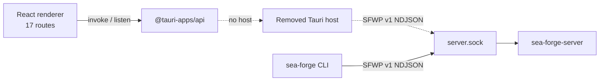

# Subsystem: Workbench

> **A React 19 renderer with ten pre-flight guards and no working native host.** The Tauri `src-tauri` shell was removed on 2026-10-13. The renderer still imports `@tauri-apps/api`, so routes can render but cannot reach a cell today.

---

## 1. Purpose

The Workbench is the graphical surface for readiness, cases, approvals, evidence, memory, assets, operations, and administration. It was designed as a closed presentation layer: the renderer draws state and sends typed queries or commands; the server decides authority and settlement.

That design is only half present. The React application survives. The native host that owned the Unix socket client, the cell supervisor, the event cursor, and the closed `SfwpQuery`/`SfwpCommand` bridge does not.

Read this page as three separate statements:

1. What the renderer contains and what its guards mean.
2. What the removed host used to provide.
3. What is therefore missing for an end-to-end Workbench session.

---

## 2. What Exists Today

| Part | Location | Status |
|---|---|---|
| React 19 renderer | `workbench/apps/desktop/src` | Present. 17 TanStack Router routes. |
| Astryx theme and design tokens | `workbench/packages/sea-forge-ui-tokens`, `@astryxdesign/theme-neutral` | Present. |
| UI components and stories | `workbench/packages/sea-forge-ui-components` | Present. |
| Generated contracts | `workbench/packages/contracts` | Present. TypeScript types and AJV validators generated from Rust `schemars`. |
| Tauri host | `workbench/apps/desktop/src-tauri` | **Deleted.** No socket client, supervisor, or IPC bridge. |
| Renderer transport | `@tauri-apps/api` `invoke` and `listen` | Still imported by hooks. Calls have no host to answer them. |

The Bun workspace still builds and tests the renderer. A browser can display routes. It cannot load real cell data.

---

## 3. Routes

TanStack Router defines 17 routes:

`/`, `/readiness`, `/thoth`, `/assets`, `/delegate`, `/models`, `/cases`, `/cases/new`, `/inbox`, `/operations`, `/evidence`, `/runs/$runId`, `/memory`, `/capabilities`, `/artifacts`, `/federation`, `/admin`.

`/runs/$runId` sits at the top level because a run can be reached from a case horizon, the evidence index, or an event stream, and an orphan run without a resolvable case still has to open.

Interactive flows use XState v5 machines; server state uses TanStack Query; forms use React Hook Form. The renderer has no direct filesystem, socket, or SQL access by design.

---

## 4. The Ten Guards

`evaluateGuard` returns one of four verdicts:

* `passed`: a source answered and the answer satisfies the guard.
* `failed`: a source answered and the answer does not.
* `indeterminate`: no source answered. This is not a pass.
* `not_applicable`: the guard does not govern this context.

| Guard | Name | Question |
|---|---|---|
| G1 | Cell Context | Is a cell attached? |
| G2 | Identity | Are actor id and role both resolved? |
| G3 | Sponsor | Does an automated actor have an eligible sponsor? Self-sponsoring operators and system actors get `not_applicable`. |
| G4 | Policy | Is a policy bundle loaded and hash-addressed? |
| G5 | Integrity | Is ledger integrity `verified`? |
| G6 | Resource | Does the requested record or asset exist and remain visible? |
| G7 | Disclosure | Is retrieval scope permitted? |
| G8 | Compatibility | Do model, template, and endpoint versions agree? |
| G9 | Readiness | Is readiness `ready` or `ready_degraded`? |
| G10 | Standing | Standing is decided server-side when a decision is submitted; there is no pre-check verb, so this usually reports `indeterminate`. |

Only `G1`, `G2`, and `G9` block routes. A `failed` blocking guard renders `GovernedDenialSurface`. An `indeterminate` guard does not block, because blocking on absent evidence would hide surfaces without making anything safer. The guards are operator pre-flight, never enforcement. The server refuses protected work on its own authority.

The old `mockGuardContext` is gone. It had asserted a verified integrity state, a loaded policy digest, and a named actor that did not exist, which let the UI display governance conclusions it had no evidence for.

---

## 5. What the Removed Host Provided

The deleted host had four jobs:

1. **Socket client.** NDJSON over `<root>/server.sock`.
2. **Cell supervision.** Attach to or launch `sea-forge-server`.
3. **Event cursor.** Persist the last acknowledged `entry_ulid` and request missed ranges after a reconnect.
4. **Closed bridge.** Two enums, `SfwpQuery` and `SfwpCommand`, validated by AJV, with no generic backend escape hatch.

The renderer hooks still assume this contract. `invoke` calls and `listen` subscriptions name commands and events that only the host used to implement.

The dashed path is the gap. The CLI path works.

---

## 6. Invariants

* **API-02, closed renderer seam.** The intended boundary is a closed, typed command and query set validated at the host. The renderer must not gain a generic `invoke_backend(method, arbitrary_json)` escape hatch when the host is restored.
* **Guards are not authority.** No guard verdict grants permission. Protected work is refused server-side even if the UI says `passed`.
* **Schema drift fails the build.** Rust contract changes must regenerate `@sea-forge/contracts`; `just workbench-check` compares the projections.
* **Unknown is not unavailable.** `indeterminate` and `failed` stay distinct in both code and UI copy.

---

## 7. Failure Modes

| Symptom | Cause | What it means |
|---|---|---|
| Every data surface is empty or errors on `invoke` | No Tauri host | Expected today. The renderer has no backend transport. |
| Guard shows `indeterminate` | No source answered | Not a pass. The cell has not reported this fact. |
| Guard shows `failed` | A source answered negatively | For G1, G2, or G9 the route is blocked with a repair route. |
| `just workbench-check` fails on contracts | Rust types changed without regeneration | Run the contract generation recipe and commit the projection. |

---

## 8. Source Trail

* [`router.tsx`](../../workbench/apps/desktop/src/router.tsx) — 17 routes, guard evaluation, denial surface.
* [`guards.ts`](../../workbench/apps/desktop/src/guards/guards.ts) — G1–G10 predicates and verdict semantics.
* [`useGuardContext.ts`](../../workbench/apps/desktop/src/guards/useGuardContext.ts) — live guard context and blocking guard list.
* [`useReadiness.ts`](../../workbench/apps/desktop/src/hooks/useReadiness.ts) — example of a hook that still calls `invoke`.
* [`ADR-004`](../decisions/ADR-004-workbench-stack.md) — stack decision and its 2026-10-13 status update.
* [`workbench/AGENTS.md`](../../workbench/AGENTS.md) — Workbench boundary and verification rules.
